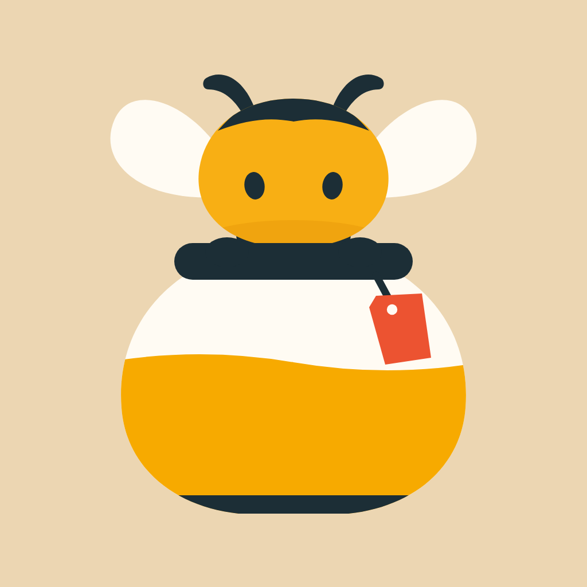
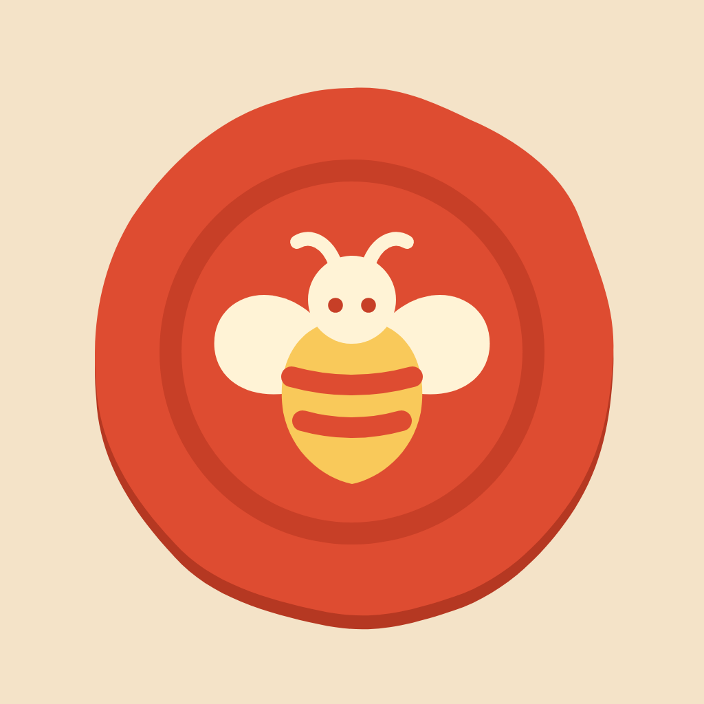
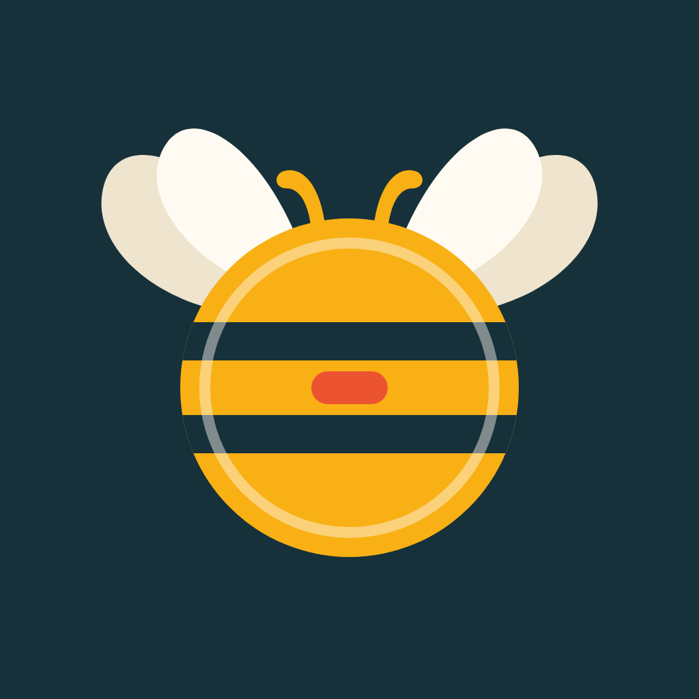
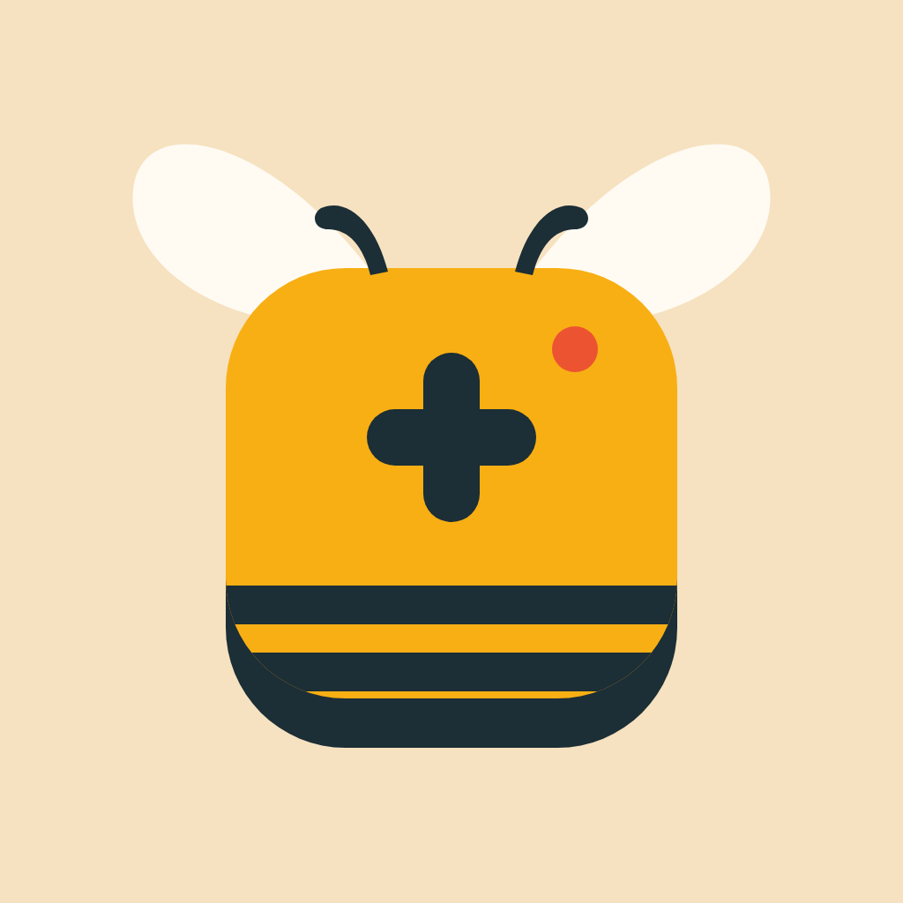
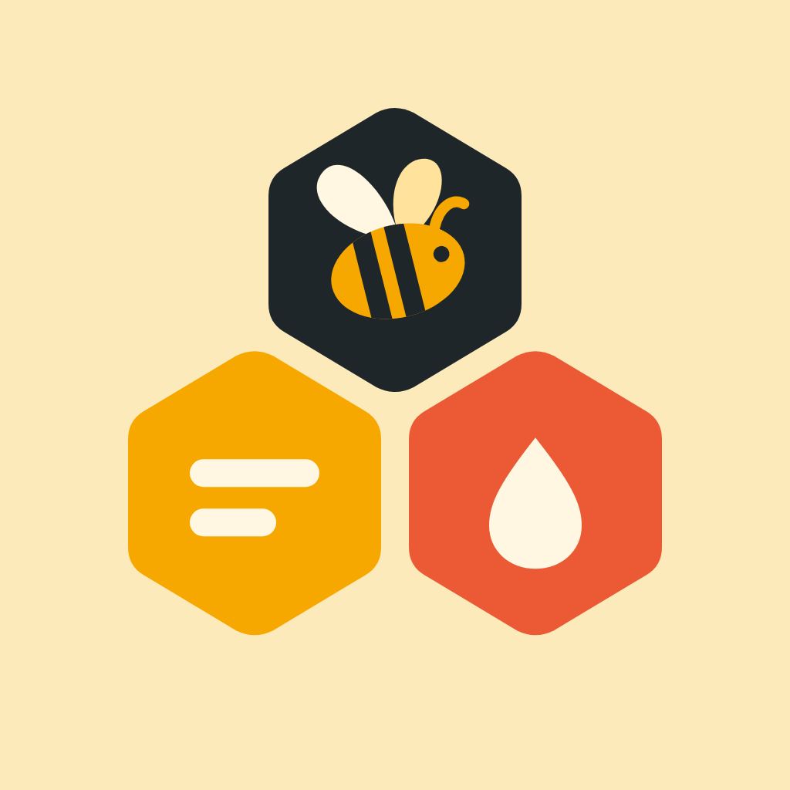
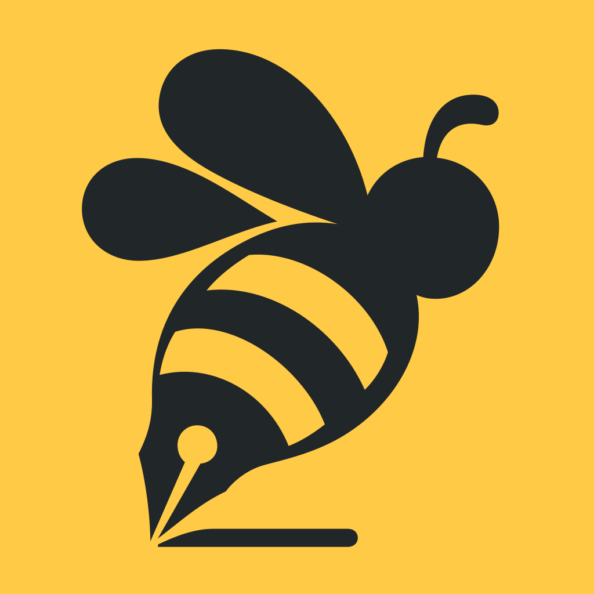
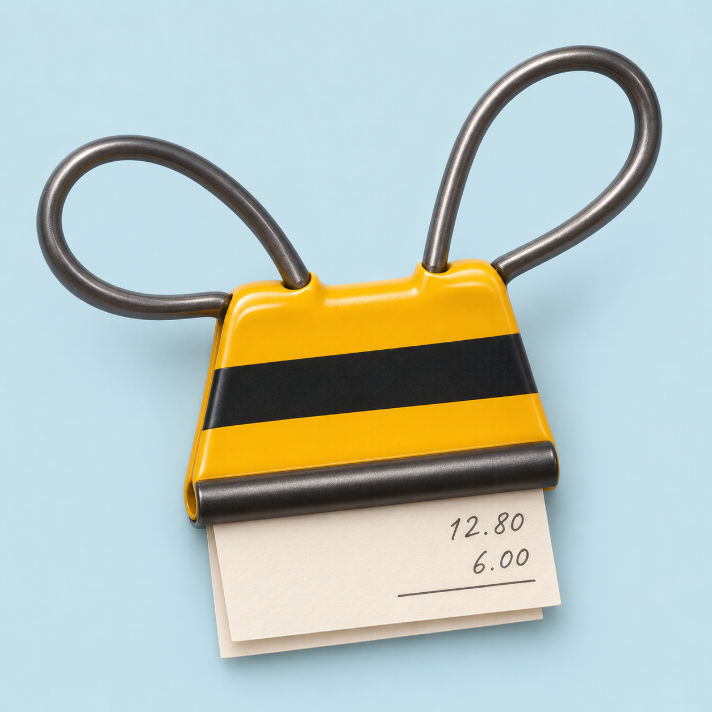
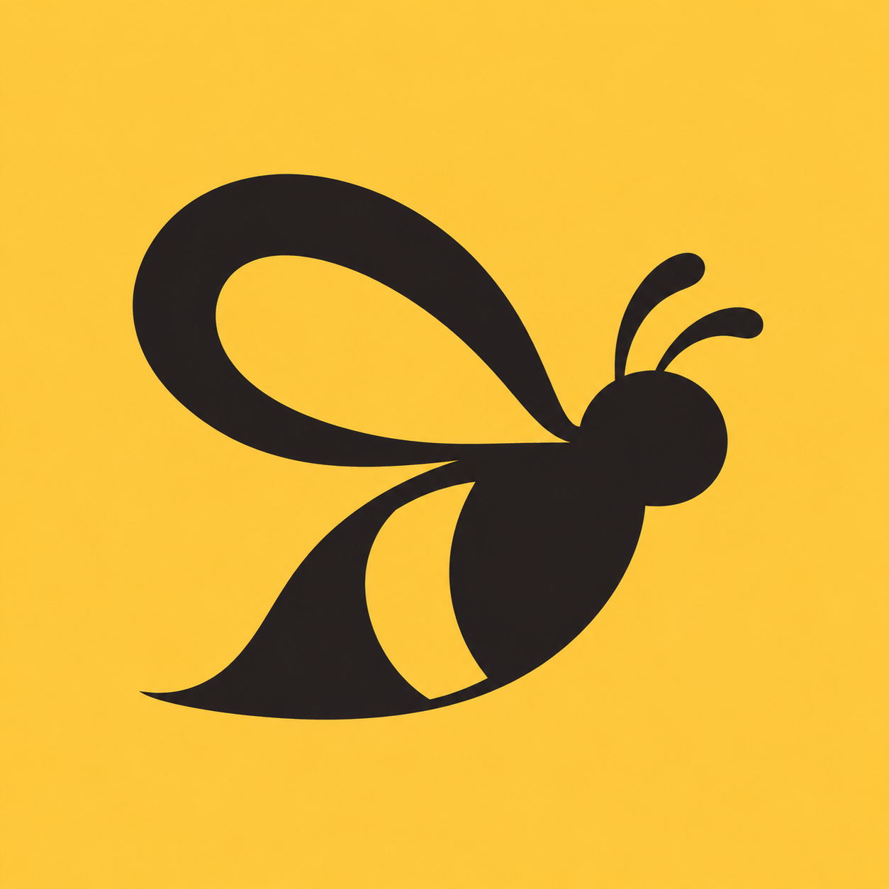

<h1>应用图标创意库</h1>

<table>
  <thead>
    <tr><th scope="col">图标与 24 px 预览</th><th scope="col">方案</th><th scope="col">稿件</th></tr>
  </thead>
  <tbody>
    <tr>
      <td>
        
        
      </td>
      <td><strong>采粉蜂</strong> 小蜂侧身飞起，前足抱住一粒花粉。 <small>2026-11-25 · 保留备选</small></td>
      <td><a href="pollen-bee/pollen-bee.svg">可编辑 SVG</a> · <a href="pollen-bee/pollen-bee.png">1024 px PNG</a> · <a href="pollen-bee/sketch.png">最初草图</a></td>
    </tr>
    <tr id="pocket-bookkeeper">
      <td>
        
        
      </td>
      <td><strong>小账房</strong> 去掉重描边与幼态五官，保留简洁温润的扁平插画小蜂捧账记下 6.50；保留初版作对比。 <small>2026-11-25 · 保留备选</small></td>
      <td><a href="pocket-bookkeeper/pocket-bookkeeper-v2.svg">扁平精修 SVG</a> · <a href="pocket-bookkeeper/pocket-bookkeeper-v2.png">扁平精修 PNG</a> · <a href="pocket-bookkeeper/pocket-bookkeeper.png">初版记账稿</a> · <a href="pocket-bookkeeper/reading-study.png">看账初稿</a> · <a href="pocket-bookkeeper/prompt.txt">生成提示词</a></td>
    </tr>
    <tr id="honey-jar">
      <td>
        
        
      </td>
      <td><strong>蜜罐守账</strong> 半满蜂蜜的奶白陶罐充当攒钱水位，简洁扁平的小蜂扶在罐口看守，颈间挂着朱红账签。 <small>2026-11-25 · 探索稿</small></td>
      <td><a href="honey-jar/honey-jar.svg">可编辑 SVG</a> · <a href="honey-jar/honey-jar.png">1024 px PNG</a></td>
    </tr>
    <tr id="daily-tally">
      <td>
        
        
      </td>
      <td><strong>每日一笔</strong> 深墨青底衬出带双红扣的日常账卡，一只圆脸卡通小蜂轻落在右上角，像刚盖下今日印记。 <small>2026-11-25 · 探索稿</small></td>
      <td><a href="daily-tally/daily-tally.svg">可编辑 SVG</a> · <a href="daily-tally/daily-tally.png">1024 px PNG</a></td>
    </tr>
    <tr id="wax-seal">
      <td>
        
        
      </td>
      <td><strong>火漆蜂印</strong> 朱红蜡质火漆印章中央压印着一只圆润小蜂，自带手账封缄的复古仪式感。 <small>2026-11-25 · 探索稿</small></td>
      <td><a href="wax-seal/wax-seal.svg">可编辑 SVG</a> · <a href="wax-seal/wax-seal.png">1024 px PNG</a></td>
    </tr>
    <tr id="honey-hourglass">
      <td>
        
        
      </td>
      <td><strong>滴蜜沙漏</strong> 两只六边形蜜室连成沙漏，蜂翅展开在腰身两侧，一滴红蜜正往下室滴落，寓意时间与预算余量。 <small>2026-11-25 · 探索稿</small></td>
      <td><a href="honey-hourglass/honey-hourglass.svg">可编辑 SVG</a> · <a href="honey-hourglass/honey-hourglass.png">1024 px PNG</a></td>
    </tr>
    <tr id="folded-page">
      <td>
        
        
      </td>
      <td><strong>折角账页</strong> 右下角折起的暖白账页搭配简洁轻盈的扁平插画小蜂，保留克制的文具纸感。 <small>2026-11-25 · 探索稿</small></td>
      <td><a href="folded-page/folded-page.svg">可编辑 SVG</a> · <a href="folded-page/folded-page.png">1024 px PNG</a></td>
    </tr>
    <tr id="coin-wing">
      <td>
        
        
      </td>
      <td><strong>飞币蜂</strong> 将金黄硬币化为蜜蜂身体，叠入双道墨青蜂纹、朱红记账横标与一对米白飞翅。 <small>2026-11-25 · 探索稿</small></td>
      <td><a href="coin-wing/coin-wing.svg">可编辑 SVG</a> · <a href="coin-wing/coin-wing.png">1024 px PNG</a></td>
    </tr>
    <tr id="keycap-bee">
      <td>
        
        
      </td>
      <td><strong>记账键蜂</strong> 把随手记一笔的「+」号按键与蜜蜂条纹、双翅结合成一枚有按压感的圆角符号。 <small>2026-11-25 · 探索稿</small></td>
      <td><a href="keycap-bee/keycap-bee.svg">可编辑 SVG</a> · <a href="keycap-bee/keycap-bee.png">1024 px PNG</a></td>
    </tr>
    <tr id="hex-vault">
      <td>
        
        
      </td>
      <td><strong>三格蜂巢</strong> 三枚圆角六边形聚成一簇蜂巢，分别盛着小蜂、两条账纹和一滴蜜。 <small>2026-11-25 · 探索稿</small></td>
      <td><a href="hex-vault/hex-vault.svg">可编辑 SVG</a> · <a href="hex-vault/hex-vault.png">1024 px PNG</a></td>
    </tr>
    <tr id="ink-nib-bee">
      <td>
        
        
      </td>
      <td><strong>落笔蜂</strong> 小蜂斜斜起飞，钢笔尖藏在蜂尾里，刚写好的一横留在原地。 <small>2026-11-25 · 探索稿</small></td>
      <td><a href="ink-nib-bee/ink-nib-bee.svg">可编辑 SVG</a> · <a href="ink-nib-bee/ink-nib-bee.png">1024 px PNG</a> · <a href="ink-nib-bee/study.png">概念原图</a> · <a href="ink-nib-bee/prompt.txt">生成提示词</a></td>
    </tr>
    <tr>
      <td>
        
        
      </td>
      <td><strong>蜂翼票夹</strong> 把夹票据的两只金属夹柄弯成蜂翅，夹身的黄黑横带就是蜂纹。 <small>2026-11-25 · 已搁置</small></td>
      <td><a href="receipt-clip/enamel-study.png">金属质感稿</a> · <a href="receipt-clip/receipt-clip.svg">平面 SVG</a> · <a href="receipt-clip/receipt-clip.png">平面 PNG</a> · <a href="receipt-clip/prompt.txt">质感稿提示词</a></td>
    </tr>
    <tr>
      <td>
        
        
      </td>
      <td><strong>收支蜂</strong> 两道蜂纹各占一行，读作收入的加号和支出的减号。 <small>2026-11-25 · 已搁置</small></td>
      <td><a href="plus-minus-bee/plus-minus-bee.svg">可编辑 SVG</a> · <a href="plus-minus-bee/plus-minus-bee.png">1024 px PNG</a></td>
    </tr>
    <tr>
      <td>
        
        
      </td>
      <td><strong>记字章</strong> 把「记」字言字旁的一点画成金色小蜂，留在账本封面的一角。 <small>2026-11-25 · 已搁置</small></td>
      <td><a href="ledger-character/ledger-character.svg">可编辑 SVG</a> · <a href="ledger-character/ledger-character.png">1024 px PNG</a></td>
    </tr>
    <tr>
      <td>
        
        
      </td>
      <td><strong>埋头蜂</strong> 小蜂一头钻进花心，只露出翅膀和圆滚滚的尾巴。 <small>2026-11-25 · 已搁置</small></td>
      <td><a href="flower-dive/flower-dive.png">概念原图</a> · <a href="flower-dive/prompt.txt">生成提示词</a></td>
    </tr>
    <tr>
      <td>
        
        
      </td>
      <td><strong>出逃算珠</strong> 算盘空出一档，那颗金色算珠长出翅膀飞走了。 <small>2026-11-25 · 已搁置</small></td>
      <td><a href="runaway-bead/runaway-bead.png">概念原图</a> · <a href="runaway-bead/first-sketch.png">初稿</a> · <a href="runaway-bead/prompt.txt">生成提示词</a></td>
    </tr>
    <tr>
      <td>
        
        
      </td>
      <td><strong>一笔蜂</strong> 墨线绕出一只翅膀，收笔处拖出微翘的蜂尾。 <small>2026-11-25 · 已搁置</small></td>
      <td><a href="brush-bee/brush-bee.png">概念原图</a> · <a href="brush-bee/prompt.txt">生成提示词</a></td>
    </tr>
  </tbody>
</table>

每个方案各有一个目录。新增时把原图、已有的源稿放在一起，在表内加一行，再运行 <code>npm run index</code> 刷新离线画廊。

