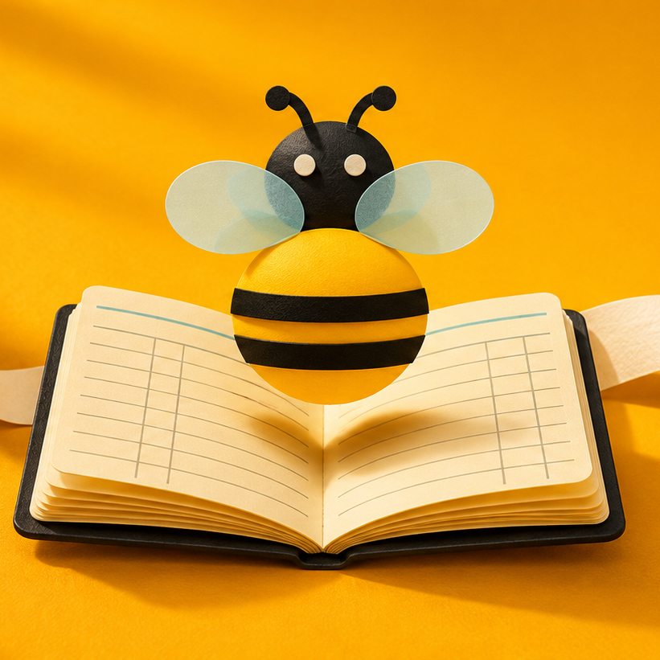

<h1>应用图标创意库</h1>

<table>
  <thead>
    <tr><th scope="col">图标与 24 px 预览</th><th scope="col">方案</th><th scope="col">稿件</th></tr>
  </thead>
  <tbody>
    <tr>
      <td>
        
        
        
      </td>
      <td><strong>蜜蜂与账本</strong> 蜜蜂悬在书脊上方。纸雕版从商店横图正中裁取，平面版用色块表现相同的构图。 <small>2026-11-26 · 纸雕与平面候选稿</small></td>
      <td><a href="bee-on-ledger/style-comparison.html">纸雕与平面尺寸对照</a> · <a href="bee-on-ledger/bee-on-ledger-crop.png">821 px 原尺寸裁图</a> · <a href="bee-on-ledger/bee-on-ledger-1024.png">1024 px 纸雕</a> · <a href="bee-on-ledger/bee-on-ledger-flat-1024.png">1024 px 平面</a> · <a href="../app-store/4.0.2/source/art/header-study.png">原始横图</a></td>
    </tr>
    <tr>
      <td>
        
        
      </td>
      <td><strong>账页蜂</strong> 两张奶油色账页构成蜂翼，翻起的纸角露出淡青色内页。 <small>2026-11-26 · 概念稿</small></td>
      <td><a href="ledger-wings/ledger-wings.png">1024 px PNG</a> · <a href="ledger-wings/paper-original.png">纸雕原图</a> · <a href="../app-store/4.0.2/source/art/header-study.png">商店视觉参考</a> · <a href="ledger-wings/prompt.txt">生成提示词</a></td>
    </tr>
    <tr>
      <td>
        
        
      </td>
      <td><strong>采粉蜂</strong> 小蜂侧身飞起，前足抱住一粒花粉。 <small>2026-11-25 · 保留备选</small></td>
      <td><a href="pollen-bee/pollen-bee.svg">可编辑 SVG</a> · <a href="pollen-bee/pollen-bee.png">1024 px PNG</a> · <a href="pollen-bee/sketch.png">最初草图</a></td>
    </tr>
  </tbody>
</table>

每个方案各有一个目录。新增时把原图、已有的源稿放在一起，在表内加一行，再运行 <code>npm run index</code> 刷新离线画廊。

